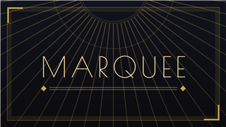

# Marquee

**HomeBoard in Deco Noir.** Marquee is a fork of [HomeBoard](https://github.com/fplanque/HomeBoard)
(Evo Factory, Apache-2.0), the Android TV / Google TV launcher, restyled with this repo's
[Deco Noir](../themes/deco_noir.yaml) Home Assistant theme so the TV matches the dashboards.



## What changed from HomeBoard

- **Theme:** [`DecoKit.kt`](app/src/main/java/com/evofactory/homeboard/DecoKit.kt) carries the Deco Noir tokens
  (ink, midnight, ivory, gold, gold-hi, emerald, sapphire, garnet) and [`Theme.kt`](app/src/main/java/com/evofactory/homeboard/Theme.kt)
  maps them onto the TV Material color scheme. Selection is gold-hi on ink instead of light grey.
- **Background:** the dashboard's sunburst, painted in Compose (`decoBackdrop()`, ported from `tools/make_sunburst.py`):
  gold rays and halo rings from the top centre, emerald and sapphire pools, bottom fans and edge pinstripes.
- **Ornaments:** square corners everywhere, smoked-glass panels with a gold hairline, the faint inner band and
  stepped corner brackets (`decoFrame()`), gold double rules under tabs, cut-corner "octagon" wells instead of round buttons.
- **Type:** Poiret One for tabs, titles, room headings and the clock (spaced capitals); Josefin Sans for text and labels;
  Jost for readings and temperatures. Bundled in `res/font/` (SIL OFL 1.1, see `app/src/main/assets/fonts_LICENSE.txt`).
- **Identity:** app name **Marquee**, application id `com.grimbelch.marquee` (installs next to stock HomeBoard),
  new Deco banner (`tools/make_banner.ps1`). Kotlin package names are unchanged so upstream fixes merge cleanly.

## Build

Needs JDK 25 and the Android SDK (platform 37, build-tools 37). On Windows:

```powershell
$env:JAVA_HOME = "$HOME\.jdks\jdk-25.0.5+8"
cd marquee
.\gradlew.bat assembleDebug   # appuild\outputspk\debugpp-debug.apk
```

Sideload with `adb install -r appuild\outputspk\debugpp-debug.apk` (see "Install the APK" below).

## Pull upstream changes

The original HomeBoard commit history is kept (imported with `git subtree`). To merge a newer HomeBoard:

```sh
git subtree pull --prefix=marquee https://github.com/fplanque/HomeBoard.git main
```

Conflicts land in the styled files only (`Theme.kt`, `DecoKit.kt` is new, plus the composables listed above).

---

*The upstream HomeBoard README follows, unchanged.*

## HomeBoard (upstream README)

A launcher for Android TV and Google TV that puts your apps, cameras, alerts and Home Assistant on one calm screen. No banners to scroll past, no account to create.

Website: https://www.evofactory.com/homeboard/

## Features

- **Cameras:** RTSP cameras in H.264 or H.265, with an optional substream for the grid. It plays as many live as your TV can decode, and shows the rest as their last picture.
- **Home Assistant:** pick sensors to display (grouped by room), the weather and its forecast, and scenes or scripts as buttons in the top bar.
- **Frigate alerts:** the last seven days of alerts, with clips that play full screen.
- **Continue Watching:** what you started in the last two weeks comes first. Apps decide what they share with the TV, so this varies from one app, and one TV, to the next.
- **App row:** move tiles, hide them, see app info or uninstall.
- **Home button helper:** optionally makes the Home button bring you to HomeBoard.
- **TV to TV:** send your settings to another TV on your network.
- **Diagnostics:** a built-in ping tool, network status, and debug logs with logins and tokens stripped out.

Cameras, Home Assistant and Frigate are all optional. Without them, HomeBoard is the most minimalistic launcher ever: your apps, and you need to scroll down to see Continue Watching.

## Privacy

There's no account, no analytics and no HomeBoard server. The app connects to the addresses you enter, and to other TVs on your network when you transfer settings. Your Home Assistant password isn't stored: the TV keeps a login you can revoke from your Home Assistant profile.

## Requirements

An Android TV or Google TV on Android 9 or later. Tested on Sony BRAVIA TVs on Android 9 and Google TV 14. Please share your own experience.

## Install the APK

Download the `.apk` file from the [latest release](../../releases/latest), then install it in one of these two ways.

### With a computer

This needs [adb](https://developer.android.com/tools/releases/platform-tools) on your computer, with the TV and computer on the same network.

1. On the TV, open **Settings → Device Preferences → About** and press OK on **Build** seven times to turn on developer options. The menu names vary by TV.
2. In **Settings → Device Preferences → Developer options**, turn on **USB debugging**. On Google TV 14, you may need **Wireless debugging** instead, which shows the address and port to use.
3. Connect, using your TV's IP address. Accept the prompt on the TV if one appears:

   ```bash
   adb connect TV_IP_ADDRESS:5555
   ```

4. Install the APK:

   ```bash
   adb install -r HomeBoard.apk
   ```

Use the name of the file you downloaded in place of `HomeBoard.apk`.

### Without a computer

1. Copy the APK to the TV with a file manager app, or download it with a browser app.
2. When Android asks, allow that app to install unknown apps.
3. Open the APK and choose **Install**.

### Afterwards

HomeBoard appears in your TV's apps. To make the Home button open it, go to the cog → HomeBoard settings, choose how it should take over, and turn on **HomeBoard Helper** in your TV's Accessibility settings. The helper is optional, and if HomeBoard fails to start a few times in a row, it switches itself off.

To update, install a newer APK the same way. Your settings stay in place.

## Build from source

Open this folder in Android Studio, or build a debug APK from the command line, with `JAVA_HOME` set to the JDK that comes with Android Studio:

```bash
./gradlew assembleDebug
```

The APK is in `app/build/outputs/apk/debug/`. A build you sign yourself can't update one from the releases page, or the other way round: Android only accepts updates signed with the same key, so you'd need to uninstall first and set up HomeBoard again.

The release build looks for its signing key outside this repo, and comes out unsigned if it isn't there.

## License

Apache License 2.0. See [LICENSE](LICENSE) and [NOTICE](NOTICE).

Copyright 2026 Evo Factory S.à r.l.
